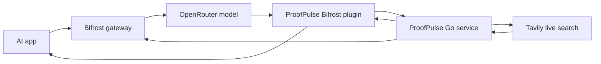

<div align="center">
  
  <h1>ProofPulse</h1>
  <p><strong>Freshness checks for AI answers.</strong></p>
  <p>A Go verification service and Bifrost gateway plugin, with live evidence search from Tavily.</p>
  <p>
    <a href="https://proofpulse-cy4nsmwp.manus.space">Product concept site</a>
    &nbsp;·&nbsp;
    <a href="#quick-start">Run with Docker</a>
    &nbsp;·&nbsp;
    <a href="#how-it-works">How it works</a>
  </p>
  <p>
    <a href="https://github.com/Tanishq-lab-Genius/proofpulse/actions/workflows/go-build.yml"></a>
    <a href="LICENSE"></a>
  </p>
</div>

---

> **Hackathon prototype.** ProofPulse highlights evidence and review signals for claims likely to change. It is not a guarantee of truth; check the cited sources before relying on a result.

## The idea

Prices, software versions, policies, and availability can change after an AI model learned about them. ProofPulse checks those time-sensitive claims against current web evidence and returns claim-level findings with source links. When evidence is unclear, it marks the claim for review instead of pretending certainty.

## How it works



The plugin checks eligible chat-completion responses before they reach the caller. For streaming requests, it buffers the answer, checks it, then releases the completed response. If verification is unavailable, the original successful model response is preserved.

## What it does

- Looks for a small set of claims likely to drift, such as prices, versions, policies, dates, and availability.
- Searches for current evidence with Tavily and returns citations beside each finding.
- Labels claims `verified`, `stale`, `unsupported`, or `uncertain`.
- Preserves the original answer when evidence or model assessment is inconclusive.
- Runs the Go service, Bifrost gateway, and matching ProofPulse plugin together in one Docker container.

## Quick start

### You’ll need

- Docker Desktop
- An OpenRouter API key for the model configured in Bifrost
- A Tavily API key for evidence search

The deployment operator configures these keys in a private environment file. They are not entered into the public website or committed to GitHub. The current example uses `openrouter/nvidia/nemotron-3.5-super-vl:free`; OpenRouter free-model availability and rate limits can change.

### Build and start

```bash
git clone https://github.com/Tanishq-lab-Genius/proofpulse.git
cd proofpulse
cp .env.docker.example .env.docker
open -e .env.docker
```

Add your own values for `OPENROUTER_API_KEY` and `TAVILY_API_KEY`. Replace `BIFROST_API_KEY` with a long private secret, then save the file. Keep `.env.docker` private; never commit or share it.

Build and run the combined stack in the background:

```bash
docker compose up -d --build
```

Docker builds the image as `proofpulse:local`. The first build can take several minutes because it compiles Bifrost, the Go service, and the Go plugin. Port `8000` is published to the host; Bifrost’s internal port is not exposed. The `bifrost-data` Docker volume keeps Bifrost configuration between restarts.

### Check the service

```bash
docker compose ps
curl -sS http://127.0.0.1:8000/health
```

Ask ProofPulse to generate an answer and check its claims:

```bash
curl -sS -X POST http://127.0.0.1:8000/api/verify \
  -H 'Content-Type: application/json' \
  -d '{"question":"Is Node.js 20 still supported? Check current official support information."}'
```

The JSON response includes the draft and verified answers, claim findings, evidence excerpts, source URLs, and counts. See [DOCKER.md](DOCKER.md) for setup, logs, restart, and troubleshooting details.

## Bifrost plugin

The custom plugin lives in [`bifrost-plugin/`](bifrost-plugin/). The Docker build compiles and installs it into Bifrost automatically. Eligible chat-completion calls are checked through the ProofPulse service, and the plugin adds the freshness review to the model response. The response header `X-ProofPulse-Status` indicates whether the answer was checked, buffered, skipped, or left unchanged.

The Docker image pins Bifrost `v2.5.0` and builds Bifrost and the plugin with the same Go toolchain. Go plugins must match the Bifrost binary’s Go version, operating system, and architecture; building them separately on different systems can cause plugin load errors.

## Website and demo status

The [Manus site](https://proofpulse-cy4nsmwp.manus.space) is the product concept site. Its browser demo is illustrative and uses simulated results. The Docker setup provides a live local API at `http://127.0.0.1:8000`; it does not automatically make that API public or connect it to the hosted site.

For a hosted website to call live verification, the backend needs a public HTTPS address, and the frontend API URL and CORS settings must use that address. A temporary tunnel works only while the tunnel and local Docker container are running. For an always-available demo, deploy the backend to a cloud host.

## Configuration

The Docker setup reads these values from `.env.docker`:

| Variable | Purpose |
| --- | --- |
| `OPENROUTER_API_KEY` | Provider credential Bifrost uses for model requests |
| `BIFROST_API_KEY` | Private virtual key ProofPulse uses to call the local Bifrost gateway |
| `TAVILY_API_KEY` | Server-side credential for live evidence search |
| `BIFROST_MODEL` | Model ID configured for Bifrost; defaults to the example OpenRouter free model |

The service listens on port `8000`. The container connects to its private Bifrost gateway at `127.0.0.1:8080`.

## Manage the local stack

```bash
# Follow logs
docker compose logs -f

# Stop the container; keep the Bifrost data volume
docker compose stop

# Start it again later
docker compose start

# Remove the container and network; keep the data volume
docker compose down
```

Use `docker compose down -v` only if you intentionally want to delete the saved Bifrost data too.

## Current limits

- The prototype focuses on claims likely to become outdated; it does not verify every sentence or every kind of fact.
- Findings depend on search coverage and model assessment. Unclear evidence should remain a human review decision.
- OpenRouter free models may be rate-limited or temporarily unavailable.
- The Manus concept-site demo is simulated; the live backend currently runs locally unless separately deployed.

## License

ProofPulse is released under the [MIT License](LICENSE).
