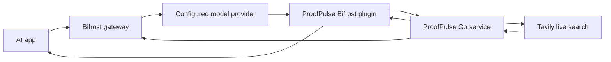

<div align="center">
  
  <h1>ProofPulse</h1>
  <p><strong>Freshness checks for AI answers.</strong></p>
  <p>A Go verification service and Bifrost gateway plugin, with live evidence search from Tavily.</p>
  <p>
    <a href="https://proofpulse-cy4nsmwp.manus.space">ProofPulse site</a>
    &nbsp;·&nbsp;
    <a href="#quick-start">Run with Docker</a>
    &nbsp;·&nbsp;
    <a href="#how-it-works">How it works</a>
  </p>
  <p>
    <a href="https://github.com/Tanishq-lab-Genius/proofpulse/actions/workflows/go-build.yml"></a>
    <a href="LICENSE"></a>
  </p>
</div>

---

> **Hackathon prototype.** ProofPulse highlights evidence and review signals for claims likely to change. It is not a guarantee of truth; check the cited sources before relying on a result.

## The idea

Prices, software versions, policies, and availability can change after an AI model learned about them. ProofPulse checks those time-sensitive claims against current web evidence and returns claim-level findings with source links. When evidence is unclear, it marks the claim for review instead of pretending certainty.

## How it works



The plugin checks eligible chat-completion responses before they reach the caller. For streaming requests, it buffers the answer, checks it, then releases the completed response. If verification is unavailable, the original successful model response is preserved.

## What it does

- Looks for a small set of claims likely to drift, such as prices, versions, policies, dates, and availability.
- Searches for current evidence with Tavily and returns citations beside each finding.
- Labels claims `verified`, `stale`, `unsupported`, or `uncertain`.
- Preserves the original answer when evidence or model assessment is inconclusive.
- Runs the Go service, Bifrost gateway, and matching ProofPulse plugin together in one Docker container.

## Quick start

### You’ll need

- Docker Desktop
- An API key for a model provider configured in Bifrost
- A Tavily API key for evidence search

Bifrost supports multiple model providers, including OpenAI (GPT models), Anthropic (Claude models), Google Gemini, OpenRouter, and others. Use a provider API key; a ChatGPT/Codex or Claude Code subscription login is not automatically an API key for Bifrost.

**This repository’s Docker preset currently configures OpenRouter only.** It expects `OPENROUTER_API_KEY` and defaults to `openrouter/nvidia/nemotron-3.5-super-vl:free`. To use another provider, add its provider configuration and API key to the Bifrost Docker config, then set `BIFROST_MODEL` to a model ID supported by that provider. The deployment operator keeps all keys in a private environment file; they are not entered into the public website or committed to GitHub.

### Build and start

```bash
git clone https://github.com/Tanishq-lab-Genius/proofpulse.git
cd proofpulse
cp .env.docker.example .env.docker
open -e .env.docker
```

For the current Docker preset, add your own values for `OPENROUTER_API_KEY` and `TAVILY_API_KEY`. Replace `BIFROST_API_KEY` with a long private secret, then save the file. Keep `.env.docker` private; never commit or share it. To switch the preset to another provider, update the Bifrost provider configuration and its environment variable as described above.

Build and run the combined stack in the background:

```bash
docker compose up -d --build
```

Docker builds the image as `proofpulse:local`. The first build can take several minutes because it compiles Bifrost, the Go service, and the Go plugin. Port `8000` is published to the host; Bifrost’s internal port is not exposed. The `bifrost-data` Docker volume keeps Bifrost configuration between restarts.

### Check the service

```bash
docker compose ps
curl -sS http://127.0.0.1:8000/health
```

Ask ProofPulse to generate an answer and check its claims:

```bash
curl -sS -X POST http://127.0.0.1:8000/api/verify \
  -H 'Content-Type: application/json' \
  -d '{"question":"Is Node.js 20 still supported? Check current official support information."}'
```

The JSON response includes the draft and verified answers, claim findings, evidence excerpts, source URLs, and counts. See [DOCKER.md](DOCKER.md) for setup, logs, restart, and troubleshooting details.

## Bifrost plugin

The custom plugin lives in [`bifrost-plugin/`](bifrost-plugin/). The Docker build compiles and installs it into Bifrost automatically. Eligible chat-completion calls are checked through the ProofPulse service, and the plugin adds the freshness review to the model response. The response header `X-ProofPulse-Status` indicates whether the answer was checked, buffered, skipped, or left unchanged.

The Docker image pins Bifrost `v2.5.0` and builds Bifrost and the plugin with the same Go toolchain. Go plugins must match the Bifrost binary’s Go version, operating system, and architecture; building them separately on different systems can cause plugin load errors.

## ProofPulse as a tool

ProofPulse adds a freshness-review step to AI workflows that use Bifrost. Bifrost routes the model request; the ProofPulse tool checks the resulting answer for time-sensitive claims, searches for current evidence with Tavily, and returns claim-level findings with source links. Claims with unclear or conflicting evidence stay visible for human review.

## Product roadmap

The hackathon prototype is the first step toward a hosted ProofPulse product. The following capabilities are planned; they are not all available in this repository yet.

1. **A live ProofPulse site.** Connect the public experience to a hosted service so people can submit a question, receive an answer from their chosen model, and inspect live claim findings and evidence.
2. **Two focused MCP tools for compatible AI clients.**
   - `check_answer_freshness` will accept a question and an answer, then return time-sensitive claims, review statuses, explanations, and cited evidence.
   - `research_evidence` will search a topic and return a dated, source-linked evidence pack. This is intended for questions where finding and tracing the evidence matters, including case and historical research.
3. **Multiple ways to use ProofPulse.** The Bifrost plugin is intended for automatic checks on model traffic routed through Bifrost. Remote MCP connections are the planned way for ChatGPT, Claude, and other compatible clients to call ProofPulse tools in a conversation. Those clients choose when to call tools; MCP does not silently check every answer in every chat. Availability depends on each client’s MCP support, account plan, and workspace settings. See the published [ChatGPT custom MCP server guide](https://developers.openai.com/api/docs/guides/custom-mcp-server) and [Claude remote MCP connector guide](https://support.anthropic.com/en/articles/11503834-building-custom-connectors-via-remote-mcp-servers).
4. **Production readiness.** Before a broader launch, add user authentication, privacy and retention controls, rate limits, operational monitoring, source-quality checks, and repeatable evaluations for supported workflows.

### Where ProofPulse can help

ProofPulse is most useful when an answer depends on facts that change or when a user needs to inspect where a claim came from. These are promising applications, not claims that every workflow is already supported:

| Area | Useful checks and research | Product fit and safeguards |
| --- | --- | --- |
| Software and developer support | API versions, deprecations, release notes, security advisories, and current product documentation | Strong first use case: changes are frequent and official documentation can be cited directly. |
| Customer support and commerce operations | Prices, plan terms, return policies, product features, and availability | Strong first use case: show the source and date, and route conflicting or unclear evidence for staff review. |
| Legal and regulatory research | Case status, cited decisions, statutes, regulations, and amendments | High value for evidence gathering; show jurisdiction and date, prefer primary legal sources, and keep legal conclusions with a qualified professional. |
| Journalism, academic work, and history | Trace claims to original documents, archives, studies, and dated reporting | The evidence-research tool can help even when a historical fact is not “stale”; distinguish primary evidence, secondary sources, and inference. |
| Finance and compliance | Current filings, rates, eligibility rules, and policy changes | Potential later use; require authoritative sources, clear scope, and human approval for consequential decisions. |
| Healthcare and public health | Current guidelines, public-health notices, and approved medicine information | Potential later use only with authoritative sources and expert review; ProofPulse should not diagnose or replace clinical judgment. |

**Suggested rollout:** start with developer documentation and customer-support claims, where source dates and changes are easy to demonstrate. Use case and history research to show the broader evidence tool. Expand into finance, compliance, or healthcare only after stronger domain-specific source controls and human-review workflows are in place. This prioritization is our product assessment; the final fit should be validated with users in each field.

## Configuration

The current Docker preset reads these values from `.env.docker`. Its provider key is specifically named `OPENROUTER_API_KEY`; it is not a universal variable for every provider.

| Variable | Purpose |
| --- | --- |
| `OPENROUTER_API_KEY` | OpenRouter credential used by the current Docker preset |
| `BIFROST_API_KEY` | Private virtual key ProofPulse uses to call the local Bifrost gateway |
| `TAVILY_API_KEY` | Server-side credential for live evidence search |
| `BIFROST_MODEL` | Model ID configured in Bifrost; defaults to the example OpenRouter free model |

The service listens on port `8000`. The container connects to its private Bifrost gateway at `127.0.0.1:8080`.

## Manage the local stack

```bash
# Follow logs
docker compose logs -f

# Stop the container; keep the Bifrost data volume
docker compose stop

# Start it again later
docker compose start

# Remove the container and network; keep the data volume
docker compose down
```

Use `docker compose down -v` only if you intentionally want to delete the saved Bifrost data too.

## Current limits

- The prototype focuses on claims likely to become outdated; it does not verify every sentence or every kind of fact.
- Findings depend on search coverage and model assessment. Unclear evidence should remain a human review decision.
- OpenRouter free models may be rate-limited or temporarily unavailable.
- The interactive demo on the ProofPulse site is illustrative; live verification is available through the Docker quick start.

## License

ProofPulse is released under the [MIT License](LICENSE).
