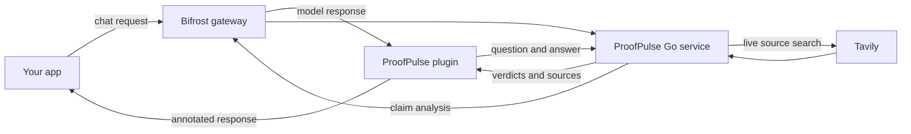

<div align="center">
  
  <h1>ProofPulse</h1>
  <p><strong>Catch stale claims before they reach your users.</strong></p>
  <p>A Go freshness service and Bifrost plugin, powered by Tavily.</p>
  <p>
    <a href="https://proofpulse-cy4nsmwp.manus.space">Concept site</a>
    &nbsp;·&nbsp;
    <a href="#how-it-works">How it works</a>
    &nbsp;·&nbsp;
    <a href="#quick-start">Quick start</a>
  </p>
  <p>
    <a href="https://github.com/Tanishq-lab-Genius/proofpulse/actions/workflows/go-build.yml"></a>
    <a href="LICENSE"></a>
  </p>
</div>

---

ProofPulse checks time-sensitive claims in AI answers against live web evidence. It is built as a small Go service with a custom Bifrost plugin: Bifrost handles model calls, Tavily searches for current sources, and ProofPulse returns claim-level signals and source links.

> **Hackathon prototype:** results depend on available sources and model assessment. Treat the verdict as evidence to review, not a guarantee of truth.

## What it does

- Finds up to three claims likely to change, such as prices, versions, policies, dates, or availability.
- Searches Tavily for current evidence and returns a verdict and source links for each claim.
- Preserves the original answer when a lookup or assessment is uncertain.
- Adds the review context to eligible buffered Bifrost chat-completion responses.
- Fails open: if ProofPulse is unavailable, the original model response continues unchanged.

## How it works



The service exposes a small HTTP API:

| Route | Purpose |
| --- | --- |
| `GET /health` | Check that the service is running |
| `POST /api/verify` | Generate or check an answer and return claim verdicts |

## Quick start

### Requirements

- Go 1.22 or later for the ProofPulse service
- A running Bifrost gateway with a model provider and model configured
- A Tavily API key for live web checks

### Run the service

```bash
git clone https://github.com/Tanishq-lab-Genius/proofpulse.git
cd proofpulse
cp .env.example .env
```

Add your Tavily key to `.env`. Set `BIFROST_MODEL` to a model available in your Bifrost configuration, then start ProofPulse:

```bash
go run ./cmd/proofpulse
```

Open [http://localhost:8000](http://localhost:8000).

Keep `.env` private; never commit API keys. Build a standalone service binary with:

```bash
go build -o proofpulse ./cmd/proofpulse
```

### Configuration

| Variable | Default | Purpose |
| --- | --- | --- |
| `ADDR` | `:8000` | HTTP listen address |
| `BIFROST_BASE_URL` | `http://localhost:8080/v1` | Bifrost OpenAI-compatible API |
| `BIFROST_API_KEY` | `local-development` | Key accepted by your local Bifrost gateway, if configured |
| `BIFROST_MODEL` | `openrouter/free` | Model name configured in Bifrost |
| `TAVILY_API_KEY` | — | Tavily key; required for live verification |

## Build the Bifrost plugin

The plugin lives in `bifrost-plugin/`. It currently handles buffered `/chat/completions` responses; streaming responses pass through without a freshness check.

Build it with the same Go version, operating system, and architecture as your Bifrost gateway:

```bash
cd bifrost-plugin
go mod tidy
mkdir -p build
go build -buildmode=plugin -o build/proofpulse.so .
```

Bifrost must be built with dynamic plugin support enabled. Go plugins also need to match the gateway's Go version and platform. See the [Bifrost plugin guide](https://github.com/maximhq/bifrost/blob/dev/docs/plugins/getting-started.mdx) and [dynamic-build instructions](https://github.com/maximhq/bifrost/blob/dev/docs/plugins/building-dynamic-binary.mdx).

Configure the plugin with the URL the gateway can use to reach ProofPulse. For Bifrost in Docker on macOS, that is commonly `http://host.docker.internal:8000`; for a native Bifrost process, use `http://127.0.0.1:8000`.

```yaml
bifrost:
  plugins:
    custom:
      - name: proofpulse-freshness
        enabled: true
        path: /plugins/proofpulse.so
        config:
          service_url: http://host.docker.internal:8000
          timeout_seconds: 180
```

## Current scope

- Up to three time-sensitive claims are checked per answer to bound the work.
- Streaming chat responses are not checked in this first version.
- The concept site contains a simulated browser demo; live verification runs through the Go service.

## License

ProofPulse is released under the [MIT License](LICENSE).