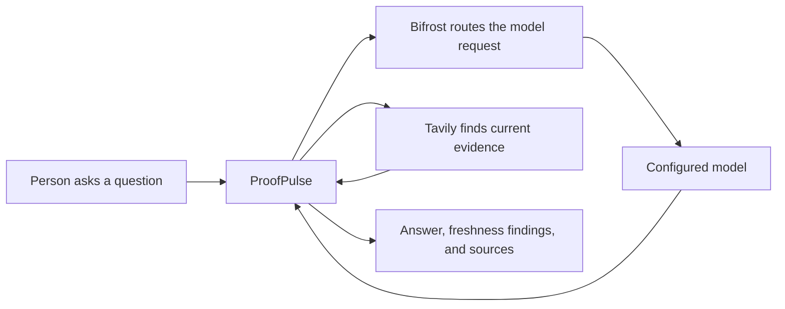

  
  <h1>ProofPulse</h1>
  
<strong>Freshness checks and evidence for AI answers.</strong>

  
One tool that checks what may have changed, shows the evidence, and flags what needs a human review.

  

    <a href="https://proofpulse-cy4nsmwp.manus.space">Product site</a>
    &nbsp;·&nbsp;
    <a href="#how-proofpulse-works">How it works</a>
    &nbsp;·&nbsp;
    <a href="#roadmap">Roadmap</a>
  

  

    
    
  

---

> **Hackathon prototype.** ProofPulse helps people inspect time-sensitive claims and their sources. A status is an evidence signal, not a guarantee of truth; review the cited material before relying on consequential answers.

## The problem

AI answers can sound certain after a price, software release, policy, or other fact has changed. People need more than a fluent answer: they need to know which claims may have drifted and what current evidence says.

## The product

ProofPulse is a freshness-checking tool for AI answers. A user asks a question; ProofPulse gets an answer from the configured model, checks claims that may change, and returns the answer with claim-level findings and source links. The freshness check is the core workflow. Evidence accompanies the findings, including when a claim appears current; unclear or conflicting evidence stays marked for review.

In the intended hosted experience, judges and end users ask questions directly. **They do not enter OpenRouter, model-provider, Bifrost, or Tavily API keys.** The project operator configures and protects those credentials on the server; the browser sends the question, not provider secrets.

## How ProofPulse works

ProofPulse checks claims individually and labels them `verified`, `stale`, `unsupported`, or `uncertain`. It preserves the original answer when the evidence is unclear instead of presenting a guess as a correction. The Bifrost plugin can apply the same freshness review to eligible model responses routed through the gateway.

## Demo status

The Go backend supports a question-only request and can generate an answer, search evidence, and return structured findings using credentials configured by the operator. The public product site is available, but its connection to a deployed public backend is still in progress. Until that connection is live, any site output labelled simulated or illustrative is not a live ProofPulse verification.

The current Docker deployment is an operator/maintainer path. It requires the project’s server-side model-provider and Tavily credentials. This is not a setup requirement for judges in the planned hosted experience.

## What the prototype demonstrates

- A question can produce an answer without the user supplying an answer or API key.
- Claims likely to change are checked against current web evidence.
- Each finding carries an explanation and source links for inspection.
- Current-looking, stale, unsupported, and unclear claims are distinguished.
- The Bifrost gateway and its ProofPulse plugin keep the model request in one routed workflow.

## Where it can help

| Area | Example time-sensitive claims | Evidence that matters |
| --- | --- | --- |
| Software and developer support | Current versions, deprecations, API behavior, security notices | Official documentation, release notes, and advisories |
| Customer support and commerce | Prices, plan terms, product features, and availability | Current product pages and published policies |
| Legal and regulatory research | Case status, cited decisions, statutes, and rule changes | Primary legal sources, jurisdiction, and date; expert review remains necessary |
| Journalism, education, and history | Dates, attributed statements, and changing interpretations | Original documents, archives, studies, and dated reporting |
| Finance and compliance | Filings, rates, eligibility, and policy updates | Authoritative sources and human approval for consequential decisions |
| Healthcare and public health | Current guidance and public notices | Authoritative health sources and qualified professional review |

These are promising applications, not a claim that the prototype is validated for every domain. The strongest initial demonstrations are software documentation and customer-support facts, where source dates and changes are easy to show. The same freshness-first workflow can also return evidence for history or case research.

## Roadmap

The roadmap keeps one product focus: **check the freshness of an answer and show the evidence that supports the review.**

### 1. Host the judge-ready experience

Deploy the ProofPulse API behind a stable HTTPS address and connect the product site to it. The operator will add model-provider, Bifrost, and Tavily credentials to the host’s private secret settings. Judges will open the site, ask a question, and see the answer and freshness findings without creating provider accounts or pasting keys.

### 2. Bring ProofPulse into compatible AI clients

Offer the same freshness-first workflow through a remote MCP tool for compatible AI clients, alongside the Bifrost plugin for model traffic routed through the gateway. A client explicitly invokes ProofPulse with a question; ProofPulse returns the answer, freshness findings, and evidence. Provider and Tavily credentials remain managed by ProofPulse on the server. The hosted MCP tool is planned and is not live yet.

### 3. Make the hosted service dependable

Add user accounts, per-user request and spend limits, monitoring, privacy and retention controls, source-quality checks, and repeatable evaluations. Keep evidence visible and route unclear or high-impact claims to human review.

### 4. Scale and offer subscriptions

As use grows, meter questions, model usage, and evidence searches; enforce budgets and abuse limits; and add subscription tiers based on predictable usage allowances. ProofPulse would continue to use project-managed provider accounts, so subscribers would not need their own model or Tavily keys. A later service can separate request handling from background research, cache eligible repeated lookups with clear freshness windows, and scale workers as demand grows. These are future plans, not features represented as complete today.

## Current implementation

The repository contains the Go verification service, the Bifrost plugin, and a Docker configuration for running the prototype stack. The current Docker preset uses OpenRouter as its configured model provider and Tavily for evidence search. Bifrost supports other providers, but changing the provider requires updating the operator’s Bifrost configuration. Keep deployment credentials in the host’s private secret store or local ignored environment file; never put them in the website, a public example, or a commit.

For operator-only local deployment notes, see [DOCKER.md](DOCKER.md). The Bifrost plugin source and its build notes are in [`bifrost-plugin/`](bifrost-plugin/).

## Project status and limits

ProofPulse is an early hackathon prototype. Claim extraction and model assessment can be imperfect, source search can return incomplete or conflicting material, and provider availability or quotas can affect a run. `uncertain` and `unsupported` are meaningful outcomes: check the evidence and do not treat the product as an automatic fact guarantee.

## License

ProofPulse is released under the [MIT License](LICENSE).
